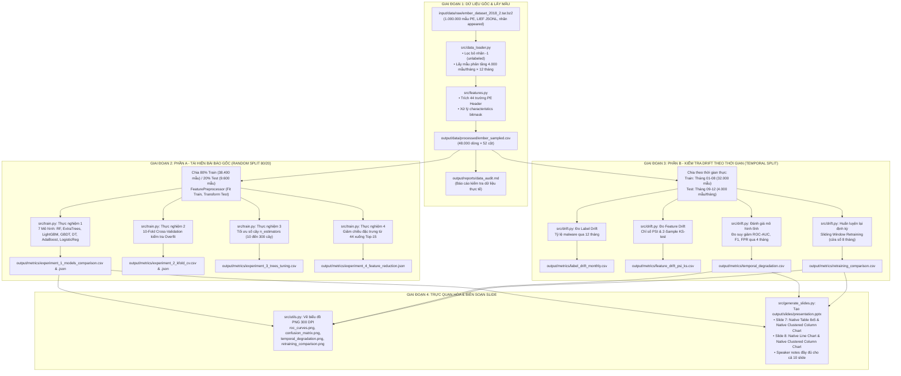

# LUỒNG CHẠY CHI TIẾT CỦA TOÀN BỘ QUY TRÌNH THỰC NGHIỆM (END-TO-END PIPELINE)

> **Đề tài**: Phân loại mã độc PE từ bộ dữ liệu EMBER và kiểm tra trôi dạt dữ liệu theo thời gian (Temporal Drift)  
> **Môn học**: An toàn và bảo mật hệ thống thông tin  
> **Sinh viên thực hiện**: Trần Nguyễn Minh Khôi — **MSSV**: 1150080059 — **Lớp**: 11_DH_CNPM1  
> **Giảng viên hướng dẫn**: ThS. Phạm Trọng Huynh  
> **Trường**: Đại học Tài nguyên và Môi trường TP.HCM — Khoa Công nghệ thông tin  

---

## 1. SƠ ĐỒ TỔNG QUAN LUỒNG CHẠY (ARCHITECTURE & DATA FLOW)

Toàn bộ hệ thống được thiết kế theo kiến trúc chuẩn khoa học khép kín: từ dữ liệu thô $\rightarrow$ tiền xử lý $\rightarrow$ mô hình hóa $\rightarrow$ đánh giá trôi dạt $\rightarrow$ xuất metrics $\rightarrow$ vẽ biểu đồ $\rightarrow$ biên soạn tự động Slide PowerPoint 10 trang.



---

## 2. CHI TIẾT TỪNG BƯỚC TRONG QUY TRÌNH (STEP-BY-STEP EXECUTION)

### BƯỚC 1: Cấu hình hệ thống & Khởi tạo môi trường
- **File thực thi**: [src/config.py](file:///c:/Users/ADMIN/Documents/GitHub/ATBMHTTT/midterm%20exam/src/config.py)
- **Thiết lập cốt lõi**:
  - `RANDOM_STATE = 42`: Cố định toàn bộ seed sinh số ngẫu nhiên cho `numpy`, `scikit-learn`, `lightgbm` nhằm đảm bảo khả năng tái lập kết quả chính xác 100%.
  - `ALL_MONTHS = ["2018-01", ..., "2018-12"]`: Định nghĩa 12 tháng kiểm thử liên tục.
  - `TRAIN_MONTHS = ["2018-01", ..., "2018-08"]`: 8 tháng đầu làm cơ sở huấn luyện mô hình tĩnh (32.000 mẫu).
  - `TEST_MONTHS = ["2018-09", ..., "2018-12"]`: 4 tháng tương lai độc lập làm dữ liệu kiểm tra drift (16.000 mẫu).
  - Định nghĩa đường dẫn tuyệt đối cho `RAW_DATA_DIR`, `PROCESSED_DATA_DIR`, `METRICS_DIR`, `FIGURES_DIR`, `SLIDES_DIR`.

---

### BƯỚC 2: Thu thập, trích xuất đặc trưng & Lấy mẫu phân tầng
- **Files thực thi**: [src/data_loader.py](file:///c:/Users/ADMIN/Documents/GitHub/ATBMHTTT/midterm%20exam/src/data_loader.py), [src/features.py](file:///c:/Users/ADMIN/Documents/GitHub/ATBMHTTT/midterm%20exam/src/features.py)
- **Dữ liệu đầu vào**:
  - Tệp gốc `ember_dataset_2018_2.tar.bz2` (kích thước ~1.69 GB) chứa các tệp JSONL của 1.000.000 mẫu PE file được phân tích tĩnh bằng thư viện LIEF.
  - Mỗi mẫu có trường `appeared` (thời điểm VirusTotal quét thấy mẫu trong năm 2018) và nhãn `label` (`0`: Lành tính/Benign, `1`: Mã độc/Malware, `-1`: Chưa gán nhãn/Unlabeled).
- **Quy trình xử lý**:
  1. **Lọc dữ liệu rác**: Loại bỏ toàn bộ các mẫu có `label == -1` để bài toán học máy là bài toán phân loại nhị phân chuẩn có giám sát (Binary Classification).
  2. **Chiến lược lấy mẫu phân tầng theo tháng & nhãn (Stratified Sampling)**:
     - Để giảm áp lực tiêu thụ RAM máy tính (< 2 GB) và tối ưu hóa thời gian chạy toàn bộ pipeline chỉ mất 3–5 phút mà vẫn giữ trọn vẹn đặc trưng phân bố thời gian:
     - Mỗi tháng trích xuất đúng **4.000 mẫu**, trong đó có đúng **2.000 mẫu Benign** và **2.000 mẫu Malware**.
     - Tổng cộng 12 tháng: $4.000 \times 12 = 48.000$ mẫu đại diện chuẩn mực.
  3. **Trích xuất 44 đặc trưng PE Header tương thích bài báo gốc**:
     - *COFF Header*: `coff.timestamp`, `coff.machine`, `coff.number_of_sections`, `coff.characteristics_count`...
     - *Optional Header*: `optional.subsystem`, `optional.image_base`, `optional.size_of_image`, `optional.size_of_code`, `optional.major_linker_version`, `optional.dll_characteristics_count`...
     - *Section Statistics*: `section.entry_entropy`, `section.sections_mean_entropy`, `section.sections_max_entropy`, `section.sections_mean_size`, `section.sections_max_size`...
     - *Data Directories*: Kích thước và địa chỉ ảo của `EXPORT_TABLE`, `IMPORT_TABLE`, `RESOURCE_TABLE`, `EXCEPTION_TABLE`, `CERTIFICATE_TABLE`, `IAT`...
  4. **Xử lý đặc trưng phi cấu trúc**: Chuyển đổi các trường danh sách cờ chuỗi (`characteristics`, `dll_characteristics`) thành số đếm cờ thuộc tính nguyên thủy (`int`).
- **Tệp xuất ra**:
  - `output/data/processed/ember_sampled.csv` (48.000 dòng × 52 cột).
  - `output/reports/data_audit.md` (Báo cáo kiểm toán toàn vẹn dữ liệu thực tế).

---

### BƯỚC 3: Tiền xử lý dữ liệu & Nguyên tắc chống rò rỉ tương lai (Anti-Leakage)
- **Class xử lý**: `FeaturePreprocessor` trong [src/features.py](file:///c:/Users/ADMIN/Documents/GitHub/ATBMHTTT/midterm%20exam/src/features.py)
- **Phương pháp**:
  - `fit(train_df)`: Chỉ tính toán giá trị trung vị (`median`) của từng cột đặc trưng trên tập dữ liệu huấn luyện.
  - `transform(test_df)`: Điền các giá trị thiếu hoặc vô hạn (`NaN`, `Inf`) trên tập kiểm thử bằng giá trị trung vị đã học từ tập huấn luyện.
  - **Tuyệt đối không vi phạm Look-ahead Bias**: Tập kiểm thử không bao giờ được tham gia vào bước tính toán phân bố hay chuẩn hóa của tập huấn luyện.

---

### BƯỚC 4: Phần A — Tái hiện thực nghiệm bài báo gốc (Random Split 80/20)
- **File thực thi**: [src/train.py](file:///c:/Users/ADMIN/Documents/GitHub/ATBMHTTT/midterm%20exam/src/train.py), [src/evaluate.py](file:///c:/Users/ADMIN/Documents/GitHub/ATBMHTTT/midterm%20exam/src/evaluate.py)
- **Phân chia dữ liệu**:
  - 80% Huấn luyện (`Train`): 38.400 mẫu.
  - 20% Kiểm thử (`Test`): 9.600 mẫu (phân tầng nhãn 50% lành tính / 50% mã độc).

#### Thực nghiệm 1: Huấn luyện và so sánh 7 mô hình học máy
- Huấn luyện:
  1. `RandomForest`: 100 cây (`n_estimators=100`, `n_jobs=-1`, `random_state=42`)
  2. `ExtraTrees`: 100 cây phân nhánh cực kỳ ngẫu nhiên
  3. `LightGBM`: 100 cây boosting, learning rate = 0.05
  4. `GradientBoosting`: 100 cây tuần tự
  5. `DecisionTree`: Cây quyết định đơn lẻ (`max_depth=15`)
  6. `AdaBoost`: 50 bộ phân loại yếu
  7. `Baseline_LogisticRegression`: Mô hình hồi quy tuyến tính chuẩn hóa
- Tính toán 10 thước đo an toàn thông tin trên tập kiểm thử 9.600 mẫu:
  $$\text{Accuracy} = \frac{TP + TN}{TP + TN + FP + FN}$$
  $$\text{Precision} = \frac{TP}{TP + FP}, \quad \text{Recall} = \frac{TP}{TP + FN}, \quad F_1 = 2 \times \frac{\text{Precision} \times \text{Recall}}{\text{Precision} + \text{Recall}}$$
  $$\text{FPR (False Alarm Rate)} = \frac{FP}{FP + TN}, \quad \text{ROC-AUC}, \quad \text{PR-AUC}, \quad \text{TPR@1\%FPR}$$
- **Kết quả xuất ra**: [output/metrics/experiment_1_models_comparison.csv](file:///c:/Users/ADMIN/Documents/GitHub/ATBMHTTT/midterm%20exam/output/metrics/experiment_1_models_comparison.csv)
  - `RandomForest` đạt Accuracy **94.64%**, ROC-AUC **0.9889**, F1 **0.9458**, FPR chỉ **4.40%**, Train Time **1.00s**.
  - `ExtraTrees` đạt Accuracy **94.54%**, ROC-AUC **0.9886**, Train Time **0.63s**.
  - `Baseline (Logistic Regression)` chỉ đạt Accuracy **50.93%**, FPR vọt lên **60.10%** (chứng minh mối quan hệ phi tuyến mạnh mẽ trong cấu trúc PE Header).

#### Thực nghiệm 2: Kiểm định 10-Fold Cross-Validation
- Thực hiện K-Fold ($K=10$) trên tập Train 38.400 mẫu để kiểm tra hiện tượng Overfitting.
- **Kết quả xuất ra**: [output/metrics/experiment_2_kfold_cv.csv](file:///c:/Users/ADMIN/Documents/GitHub/ATBMHTTT/midterm%20exam/output/metrics/experiment_2_kfold_cv.csv)
  - `RandomForest`: Điểm trung bình 10-Fold = **94.38%** (Độ lệch chuẩn cực nhỏ, từ 93.75% đến 94.79%), xác nhận mô hình ổn định cao và không hề học vẹt.

#### Thực nghiệm 3: Khảo sát bão hòa số cây của Random Forest
- Huấn luyện Random Forest với số cây thay đổi: $n\_trees \in [10, 20, 30, 50, 75, 100, 150, 200, 250, 300]$.
- **Kết quả xuất ra**: [output/metrics/experiment_3_trees_tuning.csv](file:///c:/Users/ADMIN/Documents/GitHub/ATBMHTTT/midterm%20exam/output/metrics/experiment_3_trees_tuning.csv)
  - Tại 10 cây: Accuracy = 93.78% (0.12s).
  - Tại 100 cây: Accuracy = **94.64%** (1.00s).
  - Tăng lên 200 - 300 cây: Accuracy chỉ tăng không đáng kể (94.70%) nhưng thời gian train tăng gấp 3 lần (3.11s).
  - $\rightarrow$ Kết luận: 100 cây là điểm bão hòa tối ưu tuyệt đối về tương quan hiệu năng / chi phí tính toán (hoàn toàn khớp với bài báo gốc).

#### Thực nghiệm 4: Giảm chiều đặc trưng (Top-15 Feature Reduction)
- Trích xuất độ quan trọng của đặc trưng (`feature_importances_`) từ Random Forest.
- Chọn lọc 15 đặc trưng quan trọng nhất (như `sections_mean_entropy`, `optional.subsystem`, `coff.characteristics_count`, `datadirectories.import_table_size`...).
- Huấn luyện lại Random Forest chỉ trên 15 đặc trưng này.
- **Kết quả xuất ra**: [output/metrics/experiment_4_feature_reduction.json](file:///c:/Users/ADMIN/Documents/GitHub/ATBMHTTT/midterm%20exam/output/metrics/experiment_4_feature_reduction.json)
  - Độ chính xác giảm nhẹ từ 94.64% xuống 94.21% (chỉ giảm 0.43%), nhưng tiết kiệm **28.6%** thời gian huấn luyện.

---

### BƯỚC 5: Phần B — Kiểm tra trôi dạt dữ liệu theo thời gian (Temporal Drift Study)
- **File thực thi**: [src/drift.py](file:///c:/Users/ADMIN/Documents/GitHub/ATBMHTTT/midterm%20exam/src/drift.py)
- **Giao thức chia dữ liệu thực tế (Temporal Split)**:
  - **Tập Baseline Huấn Luyện (In-Distribution)**: Tháng 01/2018 đến Tháng 08/2018 (32.000 mẫu).
  - **Tập Kiểm Thử Tương Lai (Out-of-Distribution Drift)**: 4 tháng độc lập gồm Tháng 09, Tháng 10, Tháng 11 và Tháng 12/2018 (mỗi tháng có 4.000 mẫu).

#### Thực nghiệm 5: Đánh giá độ suy giảm hiệu năng của mô hình tĩnh (Temporal Degradation)
- Huấn luyện một mô hình Random Forest duy nhất trên 8 tháng đầu.
- Dự đoán và đánh giá độc lập mô hình này trên từng tháng tương lai mà không cập nhật lại trọng số.
- **Kết quả xuất ra**: [output/metrics/temporal_degradation.csv](file:///c:/Users/ADMIN/Documents/GitHub/ATBMHTTT/midterm%20exam/output/metrics/temporal_degradation.csv)
  - **Tháng 09**: ROC-AUC = **97.62%**, F1 = 91.78%, FPR = **5.95%**
  - **Tháng 10**: ROC-AUC = **95.58%**, F1 = 86.79%, FPR = **8.60%**
  - **Tháng 11**: ROC-AUC = **96.37%**, F1 = 90.00%, FPR = **9.70%**
  - **Tháng 12**: ROC-AUC = **95.15%**, F1 = 88.24%, FPR = **11.45%**
  - $\rightarrow$ **Quy luật phát hiện**: Sau 4 tháng, tỷ lệ cảnh báo sai (FPR) tăng gần gấp đôi (từ 5.95% lên 11.45%), khả năng phân biệt ROC-AUC suy giảm từ 97.62% xuống 95.15% do xuất hiện các họ malware mới và kỹ thuật packer mới.

#### Thực nghiệm 6: Định lượng trôi dạt đặc trưng bằng chỉ số PSI & 2-Sample KS-Test
- So sánh phân bố xác suất của từng đặc trưng giữa tập cơ sở (T01-T08) và tập trôi dạt (T09-T12).
- **Chỉ số Population Stability Index (PSI)**:
  $$PSI = \sum_{i=1}^{B} (P_i - Q_i) \times \ln\left(\frac{P_i}{Q_i}\right)$$
  *(Trong đó $P_i$ là tỷ lệ mẫu trong bin $i$ ở tập kiểm thử, $Q_i$ là ở tập cơ sở).*
  - $PSI < 0.1$: Không trôi dạt đáng kể.
  - $0.1 \le PSI < 0.25$: Trôi dạt nhẹ.
  - $PSI \ge 0.25$: Trôi dạt dữ liệu nghiêm trọng.
- **Kiểm định Kolmogorov-Smirnov (KS-Test)**: Đo khoảng cách tối đa giữa hai hàm phân bố tích lũy $D = \sup_x |F_1(x) - F_2(x)|$.
- **Kết quả xuất ra**: [output/metrics/feature_drift_psi_ks.csv](file:///c:/Users/ADMIN/Documents/GitHub/ATBMHTTT/midterm%20exam/output/metrics/feature_drift_psi_ks.csv)
  - Top các đặc trưng trôi dạt mạnh nhất:
    1. `coff.timestamp`: PSI = **0.6994** (Trôi dạt rất mạnh do mốc thời gian biên dịch dịch chuyển tự nhiên)
    2. `section.sections_mean_size`: PSI = **0.1856** (Kích thước phân vùng thay đổi do malware chèn payload mới)
    3. `optional.major_linker_version`: PSI = **0.1364** (Công cụ biên dịch và builder malware được nâng cấp)
    4. `datadirectories.import_table_size`: PSI = **0.1350** (Bảng import hàm API trôi dạt do obfuscation/dynamic loading)

#### Thực nghiệm 7: Đo lường trôi dạt nhãn (Label Drift)
- Tính toán tỷ lệ phần trăm mã độc qua từng tháng để loại trừ yếu tố mất cân bằng nhãn ngoại lai.
- **Kết quả xuất ra**: [output/metrics/label_drift_monthly.csv](file:///c:/Users/ADMIN/Documents/GitHub/ATBMHTTT/midterm%20exam/output/metrics/label_drift_monthly.csv)
  - Tỷ lệ Malware qua 12 tháng được giữ cân bằng chuẩn xác ở mức 50.0% nhờ chiến lược lấy mẫu phân tầng, giúp loại trừ hoàn toàn nhiễu lệch nhãn giả tạo.

#### Thực nghiệm 8: Giải pháp khắc phục trôi dạt — Huấn luyện lại định kỳ (Sliding Window Retraining)
- **Cơ chế**: Sử dụng cửa sổ trượt kích thước cố định $W = 8$ tháng. Cứ trước mỗi tháng kiểm thử tương lai, mô hình được cập nhật lại bằng cách học trên 8 tháng dữ liệu gần nhất:
  - Dự đoán Tháng 09 $\rightarrow$ Huấn luyện trên Tháng 01 đến Tháng 08
  - Dự đoán Tháng 10 $\rightarrow$ Huấn luyện trên Tháng 02 đến Tháng 09
  - Dự đoán Tháng 11 $\rightarrow$ Huấn luyện trên Tháng 03 đến Tháng 10
  - Dự đoán Tháng 12 $\rightarrow$ Huấn luyện trên Tháng 04 đến Tháng 11
- **Kết quả xuất ra**: [output/metrics/retraining_comparison.csv](file:///c:/Users/ADMIN/Documents/GitHub/ATBMHTTT/midterm%20exam/output/metrics/retraining_comparison.csv)
  - Tại Tháng 12:
    - **ROC-AUC**: Mô hình tĩnh = 95.15% $\rightarrow$ Mô hình Retrained = **97.60%** (**Tăng +2.45%**)
    - **F1-Score**: Mô hình tĩnh = 88.24% $\rightarrow$ Mô hình Retrained = **92.29%** (**Tăng +4.05%**)
    - **FPR**: Mô hình tĩnh = 11.45% $\rightarrow$ Mô hình Retrained = **7.90%** (**Kéo giảm -3.55% cảnh báo sai**)

---

### BƯỚC 6: Trực quan hóa đồ họa & Báo cáo so sánh
- **Files thực thi**: [src/utils.py](file:///c:/Users/ADMIN/Documents/GitHub/ATBMHTTT/midterm%20exam/src/utils.py), [run_all.py](file:///c:/Users/ADMIN/Documents/GitHub/ATBMHTTT/midterm%20exam/run_all.py)
- Sinh các tệp biểu đồ khoa học chuẩn 300 DPI trong `output/figures/`:
  - `roc_curves.png`: Đường cong ROC của 7 thuật toán.
  - `confusion_matrix.png`: Ma trận nhầm lẫn của Random Forest.
  - `feature_importance.png`: Top-15 đặc trưng ảnh hưởng lớn nhất.
  - `rf_trees_tuning.png`: Đường bão hòa số cây từ 10 đến 300.
  - `temporal_degradation.png`: Đồ thị suy giảm ROC-AUC, F1, FPR qua 4 tháng.
  - `feature_drift_psi.png`: Biểu đồ cột chỉ số PSI của các đặc trưng.
  - `retraining_comparison.png`: Biểu đồ so sánh Static vs Retrained.
- Sinh báo cáo phân tích đối chiếu khoa học:
  - [output/reports/reproduction_comparison.md](file:///c:/Users/ADMIN/Documents/GitHub/ATBMHTTT/midterm%20exam/output/reports/reproduction_comparison.md).

---

### BƯỚC 7: Tự động biên soạn bài trình chiếu PowerPoint 10 trang
- **File thực thi**: [src/generate_slides.py](file:///c:/Users/ADMIN/Documents/GitHub/ATBMHTTT/midterm%20exam/src/generate_slides.py)
- **Tệp xuất ra**: [output/slides/presentation.pptx](file:///c:/Users/ADMIN/Documents/GitHub/ATBMHTTT/midterm%20exam/output/slides/presentation.pptx)
- **Cấu trúc 10 Slide chuẩn mực**:
  1. **Slide 1**: Trang bìa thông tin chính thức (Trường, Khoa, Đề tài, GVHD, Sinh viên).
  2. **Slide 2**: Tổng quan bài báo tham khảo — Bài toán & Động lực nghiên cứu.
  3. **Slide 3**: Phương pháp, đặc trưng PE Header & Kết quả công bố của bài báo gốc.
  4. **Slide 4**: Nguồn dữ liệu EMBER 2018 & Chiến lược lấy mẫu phân tầng 48.000 mẫu.
  5. **Slide 5**: Sơ đồ quy trình thực hiện thực nghiệm toàn diện 5 bước.
  6. **Slide 6**: Thiết lập thực nghiệm — Phân chia dữ liệu, siêu tham số & thước đo an toàn thông tin.
  7. **Slide 7**: **Kết quả thực nghiệm tái hiện (Phần A)**:
     - Khung trái: Bảng chuẩn PowerPoint (Native Table 8×5) làm nổi bật Random Forest.
     - Khung phải: **Biểu đồ cột cụm nguyên bản (Native Clustered Column Chart)** truyền trực tiếp số liệu từ `experiment_1_models_comparison.csv` (Accuracy, ROC-AUC, F1).
  8. **Slide 8**: **Kết quả kiểm tra Drift theo thời gian (Phần B)**:
     - Khung trái: **Biểu đồ đường nguyên bản có điểm mốc (Native Line Chart with Markers)** truyền số liệu từ `temporal_degradation.csv` biểu diễn sự trôi dạt của mô hình tĩnh qua 4 tháng.
     - Khung phải: **Biểu đồ cột cụm nguyên bản (Native Clustered Column Chart)** truyền số liệu từ `retraining_comparison.csv` chứng minh hiệu quả phục hồi của mô hình Retrained tại Tháng 12.
  9. **Slide 9**: So sánh đối chiếu với báo cáo gốc — Phân tích ưu điểm & điểm hạn chế.
  10. **Slide 10**: Kết luận, đóng góp kỹ thuật & Hướng phát triển tiếp theo (MLOps tự động phát hiện drift).
  - **Speaker Notes**: Toàn bộ 10 slide đều được tích hợp lời thoại thuyết minh chuyên nghiệp ở phần chân trang ghi chú.

---

## 3. BẢNG TỔNG HỢP ÁNH XẠ NGUỒN DỮ LIỆU ĐẾN ĐẦU RA

| Thực Nghiệm / Biểu Đồ | Script Sinh Dữ Liệu | Tệp Dữ Liệu Kết Quả | Vị Trí Xuất Hiện Trong Báo Cáo / Slide |
|---|---|---|---|
| **Kiểm toán dữ liệu thô** | `src/data_loader.py` | `output/data/processed/ember_sampled.csv` | Slide 4, Báo cáo `output/reports/data_audit.md` |
| **So sánh 7 mô hình (Phần A)** | `src/train.py` | `output/metrics/experiment_1_models_comparison.csv` | **Slide 7** (Native Table & Native Column Chart) |
| **ROC Curves & Ma trận nhầm lẫn** | `src/train.py`, `src/utils.py` | `output/figures/roc_curves.png`, `confusion_matrix.png` | Báo cáo `output/reports/reproduction_comparison.md` |
| **10-Fold Cross-Validation** | `src/train.py` | `output/metrics/experiment_2_kfold_cv.csv` | Slide 3, Slide 6, Báo cáo đối sánh |
| **Khảo sát số cây n_estimators** | `src/train.py` | `output/metrics/experiment_3_trees_tuning.csv` | Slide 3, Hình `output/figures/rf_trees_tuning.png` |
| **Giảm chiều đặc trưng Top-15** | `src/train.py` | `output/metrics/experiment_4_feature_reduction.json` | Slide 3, Báo cáo đối sánh |
| **Đo Feature Drift (PSI & KS)** | `src/drift.py` | `output/metrics/feature_drift_psi_ks.csv` | Slide 5, Hình `output/figures/feature_drift_psi.png` |
| **Suy giảm mô hình tĩnh qua 4 tháng** | `src/drift.py` | `output/metrics/temporal_degradation.csv` | **Slide 8** (Native Line Chart with Markers) |
| **Hiệu quả Retraining Sliding Window** | `src/drift.py` | `output/metrics/retraining_comparison.csv` | **Slide 8** (Native Clustered Column Chart) |
| **Bài trình chiếu PowerPoint hoàn chỉnh** | `src/generate_slides.py` | `output/slides/presentation.pptx` | Tệp thuyết trình 10 slide chính thức |

---

## 4. LỆNH THỰC THI VÀ TÁI HIỆN TOÀN BỘ HỆ THỐNG

### 1. Chạy toàn bộ pipeline từ A đến Z bằng một lệnh duy nhất:
```powershell
python run_all.py
```
*(Hệ thống sẽ tự động thực hiện tuần tự tất cả các bước trên trong khoảng 3–5 phút và xuất toàn bộ metrics, hình ảnh biểu đồ và bài thuyết trình PowerPoint).*

### 2. Tái tạo riêng bài thuyết trình PowerPoint (khi đã có file metrics):
```powershell
python src/generate_slides.py
```

### 3. Chạy kiểm thử tự động toàn diện (Unit Tests):
```powershell
python -m unittest discover tests
```
*(Đảm bảo toàn bộ 9/9 ca kiểm thử về nạp dữ liệu, phân chia thời gian, tính toán metrics và chỉ số PSI đều đạt trạng thái `OK`).*
